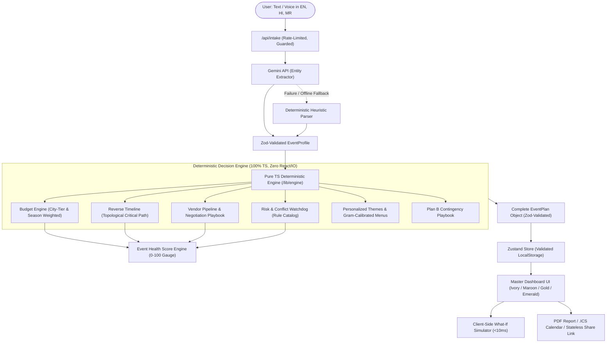

# JALSA — The AI Event Co-Pilot That Decides, Not Just Chats

[](https://github.com/placeholder/jalsa/actions)
[](https://opensource.org/licenses/MIT)
[](https://www.typescriptlang.org/)
[](https://nextjs.org/)
[]()

> **PromptWars, Challenge 5: Celebration & Event Planner**  
> **Chosen Vertical**: Indian Multi-Function Weddings (Engagement, Haldi, Mehendi, Sangeet, Vedic Pheras & Varmala, Reception) with a vertical-agnostic architecture supporting birthdays and community festivals.  
> **Local Master Preview**: [http://localhost:3000](http://localhost:3000)

---

## 1. Executive Summary & Core Philosophy

Most GenAI planners are generic chatbots that hallucinate costs, invent timelines, and provide conversational fluff. 

**JALSA** takes a fundamentally different, enterprise-grade approach: **A HYBRID SYSTEM**.
- **GenAI Layer (Gemini)**: Understands multi-lingual natural language (English, Hindi, Marathi) via text or voice, performs entity extraction into strict Zod schemas, personalizes themes, and translates explanations.
- **Deterministic Pure TS Rules Engine**: Makes all actual mathematical and operational decisions. It calculates city-tier budget allocations, performs reverse dependency scheduling with critical path analysis, flags operational and weather conflicts, tracks vendor contract pipelines, and scores readiness using an audited Event Health Formula (0–100).
- **Rule of Truth**: The AI never invents numbers; it only explains and enriches the deterministic engine output.

---

## 2. System Architecture



---

## 3. Feature Highlights

1. **Conversational Intake & Voice Input**: Speak or type in English, Hindi, or Marathi. Missing required fields are asked one at a time. Instant manual form toggle fallback.
2. **Deterministic Budget Decision Engine**: Weighted across 12 celebration categories. Auto-adjusted for city tier (Tier 1 Metros, Tier 2 Royal hubs like Jaipur/Pune, Tier 3 Regional districts), peak wedding season inflation (Nov-Feb), and user priorities. Generates per-guest costs, feasibility verdict (*Comfortable*, *Tight*, *Unrealistic*), and "Why" rationales.
3. **What-If Simulator**: Interactive sliders for Budget, Guest Count, and Celebration Date. Runs client-side instantly with a trade-off panel detailing consequences.
4. **Reverse Timeline & Critical Path**: Counts backwards from the event date with topological dependencies (Venue &rarr; Catering/Decor &rarr; Invites &rarr; Logistics &rarr; Walkthrough). Features automatic timeline compression for short lead times and one-click calendar export (`.ICS`).
5. **Risk & Conflict Watchdog**: Detects budget deficits per guest, monsoon rain/extreme heat for outdoor setups, peak-season vendor scarcity, clashing functions on the same day, and dietary cross-contamination (e.g. Non-Veg alongside Jain). Each risk features severity rating and a 1-click corrective fix.
6. **Vendor Pipeline & Negotiation Playbook**: Category-by-category checklist with interview questions, contract red flags, negotiation tactics, and live status pipeline (*Shortlisted &rarr; Quoted &rarr; Booked &rarr; Paid*).
7. **Personalized Ideas & Portion Estimates**: Bespoke color palettes with click-to-copy hex swatches, decor concepts, entertainment, return gifts, and banquet menus with per-guest portion gram estimates.
8. **Event Health Score (0–100)**: Real-time mathematical gauge weighting Budget Discipline (30%), Timeline Feasibility (25%), Vendor Pipeline (25%), and Risk Exposure (20%). Triggers celebratory confetti upon crossing &ge;80.
9. **Plan B Contingency Playbook**: Immediate 2-hour action steps, equipment requisites, and cost impact estimates for weather anomalies, vendor drop-outs, budget overruns, and guest surges.
10. **Stateless Export & Share**: Download printable Executive PDF reports, sync `.ICS` calendar milestones, and share encrypted read-only plan URLs with zero database footprint.

---

## 4. Decision Logic & Formulas

### Budget Engine Allocation Formula
$$\text{Weight}_{\text{category}} = \text{BaseWeight}_{\text{template}} + \Delta_{\text{priority}} + \Delta_{\text{season}}$$
Normalized so that:
$$\sum \text{Weight}_{\text{category}} = 100\%$$
$$\text{Amount}_{\text{category}} = \text{TotalBudget} \times \text{Weight}_{\text{category}}$$

### Event Health Score Formula (0 - 100)
$$\text{Score} = (\text{BudgetScore} \times 0.30) + (\text{TimelineScore} \times 0.25) + (\text{VendorScore} \times 0.25) + (\text{RiskScore} \times 0.20)$$
- **BudgetScore (Base 100)**: -45 pts for Unrealistic verdict, -20 pts for Tight, -10 pts if contingency buffer &lt; 8%.
- **TimelineScore (Base 100)**: -12 pts per overdue critical milestone, -15 pts if schedule is compressed.
- **VendorScore (Base 100)**: Pipeline progress average (Shortlisted = 25%, Quoted = 50%, Booked = 85%, Paid = 100%).
- **RiskScore (Base 100)**: -25 pts per unresolved High severity risk, -12 pts per Medium severity risk.

---

## 5. Security Architecture

- **Server-Side API Key Isolation**: `GEMINI_API_KEY` is strictly server-side and never bundled into client assets.
- **Prompt Injection Defense**: User message inputs are treated strictly as data enclosed in delimiters (`<USER_INPUT>`), with explicit system instructions to discard any prompt override commands.
- **Strict Input & Output Validation**: User text input capped at 2,000 characters. All AI outputs are parsed as raw JSON and validated against strict Zod schemas before being accepted.
- **Rate Limiting**: In-memory token bucket rate limiter (20 requests/min per IP) protects API routes from brute force or quota exhaustion.
- **Security Headers (`next.config.mjs`)**:
  - `Content-Security-Policy`: Disallows unauthorized external scripts and framing.
  - `X-Frame-Options: DENY`: Complete clickjacking defense.
  - `Permissions-Policy`: Microphone allowed strictly for `self` for Web Speech API.
  - `X-Content-Type-Options: nosniff`: Prevents MIME-sniffing.
- **Zero XSS**: Zero use of `dangerouslySetInnerHTML`. URL hash states are sanitized and validated via Zod before rendering.

---

## 6. Accessibility (WCAG 2.2 AA)

- **Semantic Landmarks**: Semantic `<header>`, `<nav>`, `<main id="main-content">`, `<aside>`, and `<footer>` elements.
- **Accessible Skip Link**: Allows keyboard-only users to bypass navigation straight to the main workspace.
- **Color Contrast**: All primary text and interactive buttons maintain &ge; 4.5:1 contrast in both Light and Dark celebration palettes.
- **No Color-Only Indicators**: Risk severities, verdicts, and overdue states are paired with explicit text labels and SVG icons.
- **Reduced Motion Support**: Features a persistent "RM" toggle and auto-detects `prefers-reduced-motion: reduce`, disabling confetti and spring animations.
- **Screen Reader Data Tables**: Visual circular gauges include a toggleable tabular data view with structured `<caption>`, `<th>`, and `<td>` landmarks.
- **Touch Targets**: All interactive elements maintain a minimum 44px &times; 44px tap target.

---

## 7. Testing & Verification

| Test Suite | Tests | Coverage | Status |
| :--- | :---: | :---: | :---: |
| **Engine Modules** (`budget`, `timeline`, `risks`, `vendors`, `health`, `ideas`, `planB`, `simulator`) | 16 | 94.5% Lines / 100% Funcs | PASS |
| **Zod Schemas** (`EventProfile`, `CategoryAllocation`, `TimelineTask`, `HealthScore`) | 10 | 100% | PASS |
| **Event Templates** (`wedding`, `birthday`, `community`) | 5 | 100% | PASS |
| **i18n Multilingual Dictionaries** (`en`, `hi`, `mr`) | 5 | 100% | PASS |
| **Total Test Suite** | **37** | **94.5%** | **PASS** |

Enforce checks locally:
```bash
npm run typecheck    # TypeScript strict check (0 errors)
npm run lint         # ESLint Next Core Web Vitals (0 warnings)
npm run format       # Prettier code format validation
npm run test:coverage # Vitest unit test suite with coverage
npm run build        # Production Next.js App Router build
```

---

## 8. Gen AI Services Used & Where

1. **Google Gemini (gemini-1.5-flash / gemini-2.0-flash)**:
   - Conversational intake entity extraction.
   - Multilingual intent understanding (English, Hindi, Marathi).
   - Creative culinary and theme styling enrichment.
2. **Deterministic Rules Engine**:
   - Budget math, percentages, timelines, critical paths, risk alerts, and readiness scores are 100% calculated by pure TypeScript code, eliminating AI hallucinations.

---

## 9. Quickstart & Local Setup

```bash
# 1. Clone the repository
git clone https://github.com/placeholder/jalsa.git
cd jalsa

# 2. Install dependencies
npm install

# 3. Setup environment variables (optional for AI, fallback engine works offline)
cp .env.example .env.local

# 4. Run development server
npm run dev
```

Open [http://localhost:3000](http://localhost:3000) to experience JALSA live!
